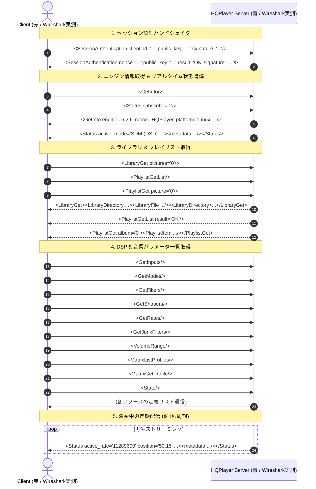

# HQPlayer TCP (Port 4321) コントロールプロトコル完全仕様書

> [!NOTE]
> **実測検証済みドキュメント**  
> 本書に記載されているすべてのリクエストおよびレスポンスの XML タグ、属性、挙動は、**Wireshark による実際の TCP パケットキャプチャおよびセッショントレースログにより確認・検証された実測仕様**です。

---

## 1. プロトコル基礎仕様

| 項目 | 仕様 |
| :--- | :--- |
| **接続ポート** | `TCP 4321` (HQPlayer Control Protocol) |
| **トランスポート層** | 生の TCP ソケット (Plaintext Raw TCP Stream) |
| **データフォーマット** | XML (ルート要素 1 つにつき 1 コマンド / レスポンス) |
| **文字エンコーディング** | クライアント: `UTF-8` / サーバー: `utf-8` |
| **デリミタ** | 各 XML ドキュメント末尾に改行（`\n` または `\r\n`） |
| **通信方向** | **赤 (Red / Client)**: クライアント → サーバー（コマンドリクエスト）<br>**青 (Blue / Server)**: サーバー → クライアント（コマンド応答 / 状態配信） |

---

## 2. セッション確立と初期化シーケンス



---

## 3. トランスポート／再生制御コマンド（Wireshark実測検証済み）

HQPlayer の再生制御において、**`<Play/>` コマンドは存在せず、`<Pause/>` が再生開始と一時停止のトグルを兼ねている**という重要な特徴があります。

### 3.1 再生・一時停止トグル (`<Pause/>`)
- **リクエスト (Client → Server)**:
  ```xml
  <?xml version="1.0" encoding="UTF-8"?><Pause/>
  ```
- **レスポンス (Server → Client)**:
  ```xml
  <?xml version="1.0" encoding="utf-8"?><Pause result="OK"/>
  ```
- **実測状態遷移と仕様（Wireshark tcp.stream 10 実測検証済み）**:
  - `<Play/>` コマンドは存在せず、**`<Pause/>` が再生トグル**として動作します。
  - **再生中 (`state="2"`)** に `<Pause/>` を送信すると、HQPlayer は `<Pause result="OK"/>` を返し、その直後の `<Status>` で **`state="1"` (一時停止中)** へ遷移します。
  - **一時停止中 (`state="1"`)** に再度 `<Pause/>` を送信すると、HQPlayer は `<Pause result="OK"/>` を返し、直後の `<Status>` で **`state="2"` (再生中)** へ復帰します。
  - `<Status>` パケットには常時 `apod="0"` (クリーン音源) または検出された Apod 歪みサンプル数、および `filter_junk="0"`, `filter_20k="0"`, `process_speed`, `input_fill`, `output_fill`, `output_delay` 等の DSP パイプラインメトリクスが出力されます。

### 3.2 停止 (`<Stop/>`)
- **リクエスト**:
  ```xml
  <?xml version="1.0" encoding="UTF-8"?><Stop/>
  ```
- **レスポンス**:
  ```xml
  <?xml version="1.0" encoding="utf-8"?><Stop result="OK"/>
  ```

### 3.3 次曲送り (`<Next/>`)
- **リクエスト**:
  ```xml
  <?xml version="1.0" encoding="UTF-8"?><Next/>
  ```
- **レスポンス**:
  - 次の曲が存在しない場合（キュー末尾等）:
    ```xml
    <?xml version="1.0" encoding="utf-8"?><Next result="Error"/>
    ```
  - 成功時:
    ```xml
    <?xml version="1.0" encoding="utf-8"?><Next result="OK"/>
    ```

### 3.4 前曲戻し (`<Previous/>`)
- **リクエスト**:
  ```xml
  <?xml version="1.0" encoding="UTF-8"?><Previous/>
  ```
- **レスポンス**:
  - 前の曲が存在しない場合（キュー先頭等）:
    ```xml
    <?xml version="1.0" encoding="utf-8"?><Previous result="Error"/>
    ```
  - 成功時:
    ```xml
    <?xml version="1.0" encoding="utf-8"?><Previous result="OK"/>
    ```

### 3.5 シーク (`<Seek position="..."/>`)
- **リクエスト**:
  ```xml
  <?xml version="1.0" encoding="UTF-8"?><Seek position="54"/>
  ```
- **レスポンス**:
  ```xml
  <?xml version="1.0" encoding="utf-8"?><Seek result="OK"/>
  ```
- **属性**:
  - `position`: シーク先再生位置（秒数）。

### 3.6 キュー内の特定曲選択ジャンプ (`<SelectTrack index="..."/>`)
HQPlayer 内部の再生キュー・プレイリスト一覧で曲をクリック・指定選択した際に送信されるコマンド。

- **リクエスト**:
  ```xml
  <?xml version="1.0" encoding="UTF-8"?><SelectTrack index="2"/>
  ```
- **レスポンス**:
  ```xml
  <?xml version="1.0" encoding="utf-8"?><SelectTrack result="OK"/>
  ```
- **属性**:
  - `index`: 再生対象のキュー内インデックス番号（例: 2曲目の場合は `2`）。

### 3.7 早送り (`<Forward/>`)
- **リクエスト**:
  ```xml
  <?xml version="1.0" encoding="UTF-8"?><Forward/>
  ```
- **レスポンス**:
  ```xml
  <?xml version="1.0" encoding="utf-8"?><Forward result="OK"/>
  ```

### 3.8 巻き戻し (`<Backward/>`)
- **リクエスト**:
  ```xml
  <?xml version="1.0" encoding="UTF-8"?><Backward/>
  ```
- **レスポンス**:
  ```xml
  <?xml version="1.0" encoding="utf-8"?><Backward result="OK"/>
  ```

---

## 4. リアルタイム状態配信 (`<Status>`)

### 4.1 購読開始 (`<Status subscribe="1"/>`)
- **リクエスト**:
  ```xml
  <?xml version="1.0" encoding="UTF-8"?><Status subscribe="1"/>
  ```
- **仕様**:
  - 送信後、同一 TCP コネクション上でサーバー主導の自発配信が開始されます。

### 4.2 ストリーミングパケット構造
```xml
<?xml version="1.0" encoding="utf-8"?>
<Status active_bits="1"
        active_channels="2"
        active_filter="poly-sinc-gauss-long"
        active_mode="SDM (DSD)"
        active_rate="11289600"
        active_shaper="ASDM7EC-fast"
        apod="0"
        begin_min="0"
        begin_sec="50"
        clips="0"
        correction="0"
        display_position="50.15510204081632395"
        filter_20k="0"
        filter_junk="2"
        input_fill="-1.00000000000000000"
        length="277.31999999999999318"
        min="0"
        output_delay="505782"
        output_fill="0.92444443702697754"
        position="50.15510204081632395"
        process_speed="16.10749295049930296"
        queued="0"
        random="0"
        remain_min="3"
        remain_sec="47"
        repeat="0"
        sec="49"
        state="1"
        total_min="4"
        total_sec="37"
        track="1"
        track_serial="16"
        tracks_total="2"
        transport_serial="105"
        volume="-3.01029995663981165">
    <metadata album="Ace Combat 7: Skies Unknown Original Soundtrack"
              albumartist="Various Artists"
              artist="Various Artists"
              bitrate="1411200"
              bits="16"
              channels="2"
              date="2019-12-30"
              extrainfo="0"
              features="0"
              float="0"
              gain="0.00000000000000000"
              samplerate="44100"
              sdm="0"
              song="444"
              uri="file:///tank/media/music/A7B3E74D_.../21 Various Artists_..._444.flac"/>
</Status>
```

| 属性 | 型 | 説明 |
| :--- | :--- | :--- |
| `active_mode` | 文字列 | DAC への出力モード（`"PCM"`, `"SDM (DSD)"`） |
| `active_rate` | 整数 (Hz) | DAC 出力サンプリング周波数（例: `11289600` = DSD256, `705600` = 16x PCM） |
| `active_bits` | 整数 | 出力ビット深度（DSD時は `1`、PCM時は `20`, `24`, `32` 等） |
| `active_filter`| 文字列 | 適用中オーバーサンプリングフィルター（例: `poly-sinc-gauss-long`） |
| `active_shaper`| 文字列 | 適用中ノイズシェーパー（例: `ASDM7EC-fast`, `LNS15`） |
| `apod` | 整数 | 音源の Apodization 歪み検出・補正数（`0` は歪みなしクリーン音源） |
| `filter_junk` | 整数 | 適用中ジャンクフィルター（`0`=none, `1`=20k, `2`=30k 等） |
| `filter_20k` | 整数 | 20kHz 帯域制限フィルター（`0`=OFF, `1`=ON） |
| `clips` | 整数 | デジタルクリッピング累計検出数 |
| `position` | 浮動小数点 (秒) | 内部エンジンの正確な現在再生位置秒 |
| `display_position` | 浮動小数点 (秒) | UI 描画用再生位置秒 |
| `length` | 浮動小数点 (秒) | トラック総再生時間秒 |
| `process_speed` | 浮動小数点 (倍速) | **DSP処理速度倍率**。実時間に対して何倍速で先行計算中か（例: `17.74` 倍速） |
| `input_fill` | 浮動小数点 | 入力デコードバッファ充足率（ストリーミング時は `-1.0` または `0.0〜1.0`） |
| `output_fill` | 浮動小数点 (0.0〜1.0) | DAC 出力バッファ充足率（例: `0.9578` = 95.8%） |
| `output_delay` | 整数 | DAC 出力レイテンシ・遅延サンプル数（例: `505782` サンプル） |
| `state` | `1` or `2` | 動作状態（`1` = 停止・一時停止, `2` = 再生中） |
| `volume` | 浮動小数点 (dB) | 出力音量ゲイン（例: `-3.01029995663981165`） |
| `uri` | URL | 再生中音源の絶対パス（`file:///tank/media/music/...`） |

---

## 5. 音響解析データ & ライブラリ (`<LibraryGet>`)

### 5.1 `<LibraryGet pictures="0"/>`
- **リクエスト**: `<?xml version="1.0" encoding="UTF-8"?><LibraryGet pictures="0"/>`
- **レスポンス構造**:
  ```xml
  <?xml version="1.0" encoding="utf-8"?>
  <LibraryGet>
      <LibraryDirectory album="BLUE GIANT (...)"
                        artist="..."
                        path="/tank/media/music/..."
                        date="2023-02-17"
                        genre="Jazz"
                        rate="44100"
                        bits="16"
                        channels="2"
                        bitrate="1411200"
                        apod="24340"
                        lufs="-11072"
                        lulr="9253"
                        peak="2108"
                        rms="-4824"
                        hash="2ac0fcc5556073cf9013c92f88c0de57">
          <LibraryFile song="Enchanter I"
                       name="03 ..._Enchanter I.flac"
                       number="503"
                       artist="..."
                       length="309"
                       apod="1"
                       lufs="-12729"
                       lulr="9640"
                       peak="166"
                       rms="-9483"
                       hash="db84838d4482f1a0f644690abfefb1c2"/>
      </LibraryDirectory>
  </LibraryGet>
  ```

### 5.2 音響パラメータの固定小数点スケール（単位仕様）
- **`lufs`**: **1/1000 LUFS**（例: `-11072` → **-11.072 LUFS**, `-8140` → **-8.140 LUFS**）
- **`lulr` (Loudness Range LRA)**: **1/1000 LU**（例: `9253` → **9.253 LU**）
- **`peak` (True Peak / Maximum Peak)**: **1/1000 dB**（例: `2108` → **+2.108 dB**, `-549` → **-0.549 dB**）
- **`rms`**: **1/1000 dB**（例: `-4824` → **-4.824 dB**）
- **`apod`**: **Apodization 歪みサンプル数**（`0` は非歪みクリーン音源）

---

## 6. DSP・フィルター・シェーパー・設定項目一覧

### 6.1 ジャンクフィルター (`<GetJunkFilters/>` / `<SetJunkFilter/>`)
- **選択肢一覧取得**: `<GetJunkFilters/>`
  - `0`: `none`
  - `1`: `20k`
  - `2`: `30k`
  - `3`: `40k`
  - `4`: `50k`
  - `5`: `2x`
  - `6`: `4x`
  - `7`: `8x`
- **設定コマンド**: `<SetJunkFilter value="2"/>` (30k を適用) → `<SetJunkFilter result="OK"/>`

### 6.2 フィルター (`<GetFilters/>` / `<SetFilter/>`)
- **一覧取得**: `<GetFilters/>` → `<FiltersItem index="0" name="IIR" value="64" .../>`
- **設定コマンド**: `<SetFilter value="48"/>` (例: `poly-sinc-gauss-long` を適用) → `<SetFilter result="OK"/>`

### 6.3 ノイズシェーパー (`<GetShapers/>`)
- **一覧取得**: `<GetShapers/>` → `<ShapersItem description="Gen7" index="25" name="ASDM7EC-super" value="20"/>` 等全36種。

### 6.4 サンプルレート (`<GetRates/>`)
- **一覧取得**: `<GetRates/>`
  - `0`: Auto
  - 44.1k系: `2822400` (DSD64), `5644800` (DSD128), `11289600` (DSD256), `22579200` (DSD512)
  - 48.0k系: `3072000` (DSD64), `6144000` (DSD128), `12288000` (DSD256), `24576000` (DSD512)

### 6.5 Matrix プロファイル (`<MatrixListProfiles/>` / `<MatrixGetProfile/>` / `<MatrixSetProfile/>`)
- **一覧取得**: `<MatrixListProfiles/>` → `<MatrixProfile name="DX1"/><MatrixProfile name="LANDER"/>...`
- **現在値取得**: `<MatrixGetProfile/>` → `<MatrixGetProfile result="OK" value="LANDER"/>`
- **即時切り替え**: `<MatrixSetProfile value="DX1"/>` → `<MatrixSetProfile result="OK"/>`

### 6.6 出力モード一覧 (`<GetModes/>`)
- `index="0"`: `[source]` (`value="-1"`)
- `index="1"`: `PCM` (`value="0"`)
- `index="2"`: `SDM (DSD)` (`value="1"`)

### 6.7 入力ソース一覧 (`<GetInputs/>`)
- `<GetInputs/>` → `<GetInputs result="OK"><InputsItem name="cd:"/><InputsItem name="ALSA Loopback"/></GetInputs>`

---

## 7. 音量制御 (`Volume` / `VolumeRange`)

- **制御範囲・可否取得**:
  `<VolumeRange/>` → `<VolumeRange adaptive="0" enabled="0" max="0.0" min="-12.0"/>`
- **音量設定**:
  - `enabled="1"` の場合: `<Volume value="-3"/>` → `<Volume result="OK"/>`
  - `enabled="0"`（音量固定/無効環境）の場合: `<Volume value="-3"/>` → `<Volume result="Error"/>`

---

## 8. エンジン構成一括照会 (`<State/>`)

- **リクエスト**: `<State/>`
- **レスポンス**:
  ```xml
  <State active_mode="1"
         active_rate="11289600"
         adaptive="0"
         convolution="0"
         filter="48"
         filter1x="48"
         filterNx="48"
         filter_20k="0"
         filter_junk="2"
         invert="0"
         matrix_profile="LANDER"
         mode="2"
         random="0"
         rate="0"
         repeat="0"
         shaper="24"
         state="1"
         volume="-3.01029995663981165"/>
  ```

